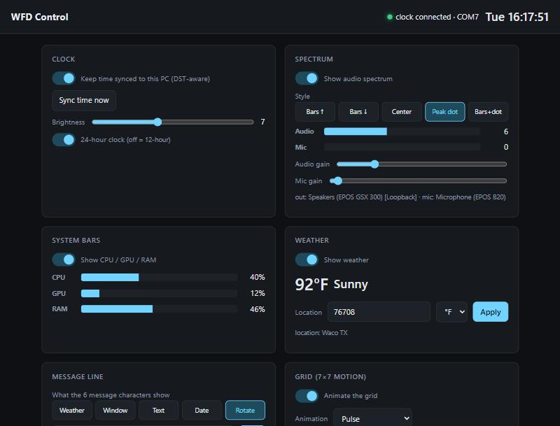
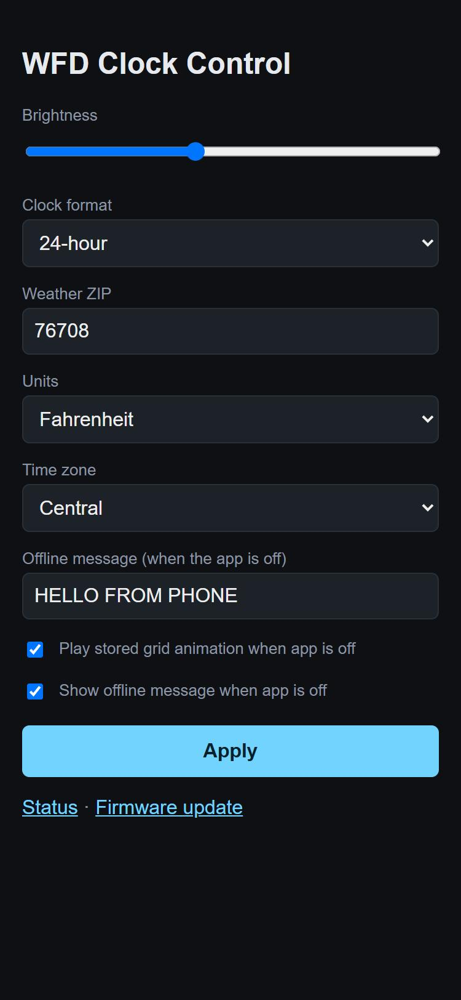
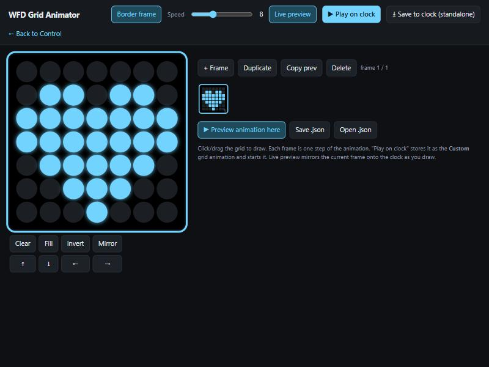

# WFD — custom firmware & control app for the EleksWFD clock

[](https://github.com/bstag/elekswfd-custom-firmware/actions/workflows/ci.yml)
[](https://github.com/bstag/elekswfd-custom-firmware/releases/latest)


Open replacement firmware and a PC companion app for the **EleksMaker EleksWFD** desk
clock (the LED‑matrix "word/weather/spectrum" clock). The stock firmware and its
unmaintained Windows tool are replaced entirely, turning the clock into a fully
controllable, WiFi‑connected device.

| PC app dashboard | The clock's own page (phone) | Grid animator |
|---|---|---|
|  |  |  |

This started as reverse engineering of the stock device and grew into a complete
custom firmware. If you have one of these clocks, you can go on the same adventure —
or just flash the result and use it.

> The original vendor tool (`EleksWFD_EN.exe`, `translations/`, `esptool/`, etc.) is
> still in this folder for reference. Everything **we** built lives in `wfd-firmware/`,
> `wfd-app/`, `wfd-control/`, and the `docs/` + `*.md` files.

---

## What it does

Runs on an **ESP32‑WROOM‑32D** driving a **TM1680** LED matrix, a **DS3231** RTC, three
buttons, and an electret mic.

**Standalone (no PC — over WiFi):**
- Self‑correcting **NTP time**, DST‑aware, **12‑ or 24‑hour**
- **Weather** (word + temperature) fetched directly from Open‑Meteo
- A **web dashboard** on the clock (live preview, every setting) plus a basic **phone control panel** (brightness, weather location/units, timezone, message
  line, standalone toggles) and a tap‑to‑pick **WiFi setup** page
- **OTA firmware updates** with one click in the PC app, or from the browser — no USB after the
  first flash
- The PC app drives it over **USB or WiFi** (finds `wfd-clock.local` by itself; switches to USB
  when plugged in)
- Listens through its own **microphone**: a bass/treble spectrum and sound‑reactive grid
  animations when the PC is off
- Plays its own **grid animation** (eleven built‑ins, or one you drew), and runs its own **message line** (text with live
  `{time}`/`{date}`/`{temp}`, date, temperature, or a rotation) when the PC app is off

**With the PC companion app (`wfd-app`, one small Rust exe that starts at login):**
- **Spectrum** visualizer — PC audio output + microphone, five styles
- **CPU / GPU / RAM** bar meters
- **Message line** — scrolling window title, custom text (with date/time placeholders), weather temp, date, or a rotation
- **7×7 grid** — 13 animations incl. audio/CPU‑reactive, plus a **drawing tool**
- **Top‑row icons** (audio meter / system status) and **logo** toggle
- Sets time, weather location, brightness, and uploads animations/messages to flash
- **Updates the clock's firmware** (it ships the matching build) and sets the clock's **web
  password over USB only**

Full teardown of how the panel is wired is in [docs/HARDWARE.md](docs/HARDWARE.md).

---

## Quick start

### 1. Flash the firmware (USB, one time)
```bash
pip install esptool pyserial
python wfd-firmware/flash_usb.py
```
(The firmware files are also attached to each [release](https://github.com/bstag/elekswfd-custom-firmware/releases/latest).)
Use a **USB 2.0 port** — the CH340 bridge won't enter flashing mode on USB 3. See
[docs/FLASHING.md](docs/FLASHING.md) if it won't connect. (Developers can instead
`cd wfd-firmware/clock && pio run -t upload`.)

### 2. Connect it to WiFi (phone, one time)
On first boot the clock hosts a **"WFD-Setup"** WiFi network. Join it, a setup page
opens (or browse to `http://192.168.4.1`), pick your **2.4 GHz** network (the ESP32
can't see 5 GHz), enter the password, Save. It restarts and joins your WiFi, then
syncs time and weather on its own.

### 3. (Optional) Install the PC app for the live features
Download `wfd-app-…-windows-x64.zip` from the [latest release](https://github.com/bstag/elekswfd-custom-firmware/releases/latest), unzip it and run
```powershell
powershell -ExecutionPolicy Bypass -File install.ps1
```
It installs the app for your user, starts it at login and opens the dashboard at
`http://127.0.0.1:8737`. Nothing else is needed. From a clone, the same script in `wfd-app\`
builds it first (needs Rust from [rustup.rs](https://rustup.rs)). See
[docs/APP.md](docs/APP.md). (The original Python app still runs too: `cd wfd-control`,
`uv run app.py`.)

After step 1, **every future firmware update is wireless**: press **Update clock** in the
app (Connection & firmware), or open the clock's web page, go to *Firmware update*, and
upload a new `wfd-clock-firmware.bin`.

---

## Repo layout

| Path | What |
|---|---|
| `wfd-firmware/clock/` | The ESP32 firmware (PlatformIO project) |
| `wfd-firmware/releases/` | Prebuilt binaries (`-merged.bin` for USB, `-firmware.bin` for OTA) |
| `wfd-firmware/flash_usb.py` | One‑command USB flasher |
| `wfd-firmware/tools/` | Reverse‑engineering + mapping tools (LED mapper, segment mapper, fonts) |
| `wfd-app/` | The PC companion app in Rust: one exe, `install.ps1` sets it up at login |
| `wfd-control/` | The original Python app (reference for the Rust port, and its test suite) |
| `legacy/` | Superseded code kept for reference (stock-protocol web app, old headless daemon) |
| `docs/` | Detailed documentation (see below) |
| `PROTOCOL.md` | The clock's serial command protocol |
| `firmware-backup/` | A full 4 MB backup of the original stock firmware |

## Documentation

- **[docs/FLASHING.md](docs/FLASHING.md)** — USB first‑flash, WiFi setup, OTA updates, toolchain
- **[docs/HARDWARE.md](docs/HARDWARE.md)** — chips, pinout, the LED/segment map and how it was found
- **[docs/FIRMWARE.md](docs/FIRMWARE.md)** — firmware architecture, serial commands, web endpoints, NVS
- **[docs/APP.md](docs/APP.md)** — the PC app: install, settings, USB/WiFi link, firmware updates, tests
- **[PROTOCOL.md](PROTOCOL.md)** — serial protocol reference (also covers the stock firmware)

## Restoring the stock firmware

The original firmware is backed up and the vendor images are present. To go back:
```bash
# stop the PC app first (it holds the serial port), then over USB 2.0:
esptool --chip esp32 --port COMx write-flash 0x10000 translations/qt_ru.qm
```
Or write the full backup `firmware-backup/elekswfd_flash_backup.bin` at `0x0`.

## Credits

Built by reverse‑engineering the EleksWFD. Inspired by the
[EleksTubeHAX](https://github.com/aly-fly/EleksTubeHAX) project (custom firmware for the
sibling EleksTube IPS clock). Weather by [Open‑Meteo](https://open-meteo.com/).
