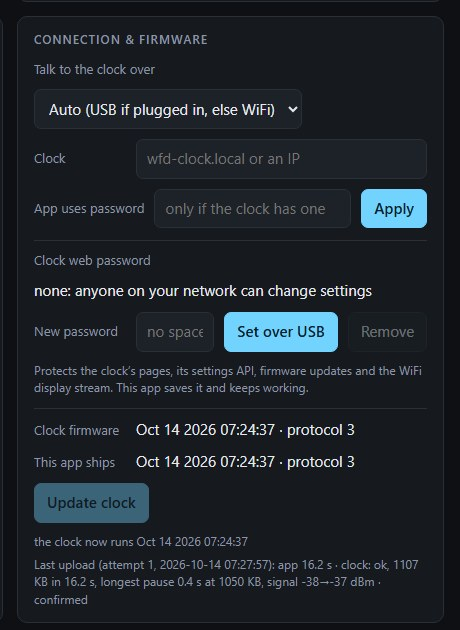

# WFD Control (PC app)

A local web app that serves a dashboard **and** runs the background services that feed the
clock the live, PC‑only data over USB or WiFi.

There are two implementations with the same behaviour, settings file and pages:

- **`wfd-app/` (Rust): the one to use.** A single `wfd-app.exe`, installed and started at
  login by `wfd-app\install.ps1`. See [wfd-app/README.md](../wfd-app/README.md).
- **`wfd-control/app.py` (Python):** the original, kept as the reference the Rust port is
  tested against. New features go into the Rust app only. The rest of this page describes
  features both share, and says where one is Rust-only.


## Running

The Rust app: download the zip from the [latest release](https://github.com/bstag/elekswfd-custom-firmware/releases/latest), unzip, and run
`powershell -ExecutionPolicy Bypass -File install.ps1` (no Rust needed). From a clone (needs
Rust from [rustup.rs](https://rustup.rs)):

```powershell
powershell -ExecutionPolicy Bypass -File wfd-app\install.ps1   # build, install, start at login
cd wfd-app; cargo run --release -- --no-browser                 # or run it by hand
```
It installs to `%LOCALAPPDATA%\WFD Clock\` (settings: `wfd_config.json` there). Run the
installer again after pulling changes.

The Python app:

```bash
cd wfd-control
uv run app.py              # uv reads the inline deps; or use a venv:
# python -m venv .venv && .venv/Scripts/pip install pyserial numpy pyaudiowpatch psutil
# .venv/Scripts/python app.py
```
Dashboard: **http://127.0.0.1:8737**. Add `--no-browser` to not auto‑open.

Dependencies: `pyserial`, `numpy`, `pyaudiowpatch` (WASAPI loopback), `psutil`. The
drawing tool and fonts use `font14.py` / `grid_anim.py` (in the same folder).

## What it provides

- **Clock** — time sync (DST‑aware), **12/24‑hour** format, brightness
- **Spectrum** — PC audio output (WASAPI loopback) on the left column, default mic on the
  right; five styles; gain sliders
- **System bars** — live CPU (psutil) / GPU (`nvidia-smi`) / RAM
- **Weather** — resolves a ZIP or "Town, State" and pushes it; shows condition + temp
- **Message line** — weather temp / window title / custom text / **date** / rotation; custom text supports `{date} {time} {time12} {day} {temp}` placeholders
- **Grid** — 14 animations incl. audio/CPU‑reactive and **Weather** (a pixel scene for the current
  weather; *Grid scene* under Weather & time zone picks one by hand); **Save to clock** makes the clock play the
  built‑ins itself, audio and mouth from its own mic (or stores your drawing); the **grid animator** (`/draw`) is a 7×7 frame editor with live preview. The same page is served by the clock at `http://wfd-clock.local/draw`; there it starts from the clock's stored drawing and saves straight to it
- **Top row** — icon modes (audio meter / system status) and the logo toggle
- **Offline message** + standalone toggles — what the clock shows when the app is off. *Save to clock*
  sends the text (placeholders and all); the clock's phone page picks the mode, rotation and speed

## How it drives the clock

A worker thread connects to the CH340 port (auto‑found by VID/PID `1A86:7523`), then at
~30 fps sends `SPEC`, and as needed `BARS`, `WX`, `MSG`, `GRID`, `ICON`, `LOGO`,
`STYLE`, `BRIGHT`, `GEO`, plus `SET` every 10 min. Uploads (`Save to clock`) go through
`GANIM` (built‑in grid animation, by name), `GCLR/GADD/GCOMMIT` (drawn grid frames) and `OMTEXT`
(offline message text). It reconnects automatically if the clock
is unplugged.

**It holds the serial port.** Stop the app (`Stop-Process -Name wfd-app`, or end `pythonw.exe`
for the Python app) before flashing
over USB or running the old vendor tool. (OTA over WiFi does **not** need the port free.)

## One dashboard

The app serves the clock's own dashboard (`wfd-firmware/clock/web/dashboard.html`), the same file
the clock serves at `http://wfd-clock.local/`. Served by the app, it also shows the PC sections:
PC audio and gains, CPU/GPU/RAM bars, the PC's weather, top‑row icons and logo, the message line
and grid *while the app runs*, and Connection & firmware. Everything else (brightness, format,
spectrum style, the mic, what the clock does when the app is off, ZIP, units, time zone) is the
clock's, so it looks and works the same on both. The grid animator (`/draw`) is shared the same
way. Tests check that every setting a shared page sends has an owner, and that every clock
setting has a control on the dashboard.

## Settings

Every setting has one owner:

- **The clock** owns everything about itself: brightness, 12/24‑hour, spectrum style, units,
  time zone, weather ZIP, the offline message, and all "when the app is off" behaviour. They
  live in the clock's flash. The app reads them over USB (`CFG`) when it connects and every
  5 s, and changes them with `CFGSET`. The clock checks them exactly as its own dashboard does.
  A change made on the clock's dashboard or phone page therefore shows up in the app, and the
  app never overwrites it.
- **The app** owns what needs the PC: PC audio spectrum and gains, CPU/GPU/RAM bars, the live
  message line (window title, custom text, rotation), live grid animations, icons and logo.
  These persist in `wfd-control/wfd_config.json`.

The app's UI shows both together. Saving a clock setting while the clock is unplugged fails
with "clock not connected", and the clock's own error messages (e.g. a bad ZIP) are shown
as they are. The app's weather uses the clock's ZIP and units. It sends a location to the clock
(`GEO`) only if the clock has none.

## Auto‑start at login (Windows)

`wfd-app\install.ps1` adds a **WFD Clock** shortcut to your Startup folder (`shell:startup`)
that runs `wfd-app.exe --no-browser`. To disable, delete the shortcut.

For the Python app, `wfd-control/wfd_control.vbs` launches it hidden with `pythonw.exe`: put a
copy in Startup (e.g. "WFD Clock Helper.vbs") and point its paths at a **persistent** Python
env. The Rust installer renames that copy to `.vbs.disabled` so only one app runs.

## Connection

The app talks to the clock over **USB** or **WiFi** (setting `link`, in the *Connection* section):

- **Auto** (default): USB when the clock is plugged in, otherwise WiFi. While on WiFi it checks
  for USB every 10 s and switches over.
- **USB only** / **WiFi only**.

If the clock is plugged in but Windows has no driver for its USB chip (no COM port), the
dashboard says so and links to the driver (Rust app; see
[FLASHING.md](FLASHING.md#the-usb-driver-ch340)). `cargo run --example usb_probe` in `wfd-app/`
lists the USB devices the app sees.

Over WiFi, each frame's display commands go to the clock as one UDP packet, and settings and
uploads use the clock's web API. The clock is found as `wfd-clock.local`: the app asks over mDNS
itself, because Windows doesn't always resolve `.local` names. You can also enter an IP
(`clock_host`). Over USB the clock tells the app its WiFi address (`_ip` in `CFG`), so "Update clock" and a switch to WiFi go straight there; otherwise the app remembers the last address that worked, and forgets it if it stops answering. To set the clock's web password, use *Clock web password* in this section while the clock is on USB: it's sent over USB only, so only someone with the clock in hand can change it, and the app saves it as its own password (`clock_pass`) so WiFi and updates keep working. (Rust app; the Python app doesn't have this.) If the clock already has a web password set some other way
(serial `WEBPASS`), enter it as the clock password (`clock_pass`). The app never shows it back.
A clock with internet time (NTP) keeps its own time over WiFi; the app sends the PC's time only
if the clock hasn't synced.

The clock still needs power, so a USB charger is enough once the app uses WiFi.

**Firmware updates:** the Connection section shows the clock's firmware next to the one this app
ships (`wfd-firmware/releases/`). It warns if the clock is older than the app expects (protocol),
and **Update clock** uploads the shipped build over WiFi (this works while the display runs over
USB too). The app then watches the clock until it reports the new build. That takes about 20 s.



If an upload stalls, the app tries once more.

Every attempt is logged (Rust app) as one JSON line in `ota-log.jsonl` next to the settings file:
the app's side (seconds sending, any error, whether the new build came up) and the clock's own
report of that upload (`state.ota`, see FIRMWARE.md). The dashboard shows the last one under the
Update button. A stall shows up as a large `max_gap_ms` and `gap_at` says how far in it came.

When the app quits normally it sends `BYE`, so the clock takes over at once instead of after 2 s.

## App and clock together

While the app is connected it drives the live display (spectrum, bars, message line, grid).
When it stops, the clock carries on with its own settings after 2 s. Settings never fight:
see *Settings* above.

## Note on the older headless helper

`legacy/daemon/wfd_daemon.py` is a superseded headless version (time + mic spectrum only).
The PC app replaces it with the full UI and feature set.

## Tests

The Rust app: `cd wfd-app && cargo test` (see [wfd-app/README.md](../wfd-app/README.md)).
The Python suite below also covers the firmware's C++ engines and the device tests.
GitHub Actions (`.github/workflows/ci.yml`) runs both suites, clippy and the firmware build on
every push and pull request; the firmware job also fails if `src/web_pages.h` wasn't regenerated
after a page change.

```bash
wfd-control/test.bat            # or: cd wfd-control && uv run --with-requirements requirements.txt --with pytest pytest
```

No clock, network or audio device is needed, and your `wfd_config.json` is never read or
written. The suite covers:

- **`test_clocklink.py`** runs the serial worker against a fake port on simulated time.
  It compares every line sent in a busy 45 s scenario to `tests/golden/clocklink.log`, and
  checks specific behaviour (reconnect re-sends settings, uploads, sync, spectrum off).
- **`test_api.py`** covers the local HTTP API: header check, validation, status, uploads.
- **`test_rendering.py`** covers settings validation, message scrolling and icons.
- **`test_protocol.py`** cross-checks against the firmware source: every command the app
  sends is handled in `main.cpp`, `font14_table.h` matches `font14.py`, and the icon count
  matches `clock_panel.h`.

- **`test_grid_engine.py`** compiles the firmware's `grid_engine.h` on the PC and checks it
  against `grid_anim.py` (skipped if there's no C++ compiler).
- **`test_mic_dsp.py`** compiles the firmware's `mic_dsp.h` and checks it on simulated tones and
  on a real recording from the clock (`tests/host/mictrace_room.txt`).
- **`test_wifi_link.py`** drives the app's WiFi link against a simulated clock (UDP packets, HTTP
  settings and uploads, reconnects, switching to USB); **`test_mdns.py`** checks the lookup.
- **`test_device_api.py`** / **`test_device_net.py`** (opt‑in) tests the clock's JSON API on a real clock and restores
  everything it changes: `set WFD_CLOCK=<clock ip> && test.bat -m device`.

If you change what the app sends on purpose, the golden test fails with a diff. Regenerate
the log, then review its diff in git before committing:

```bash
cd wfd-control && WFD_UPDATE_GOLDEN=1 uv run --with-requirements requirements.txt --with pytest pytest tests/test_clocklink.py
```
