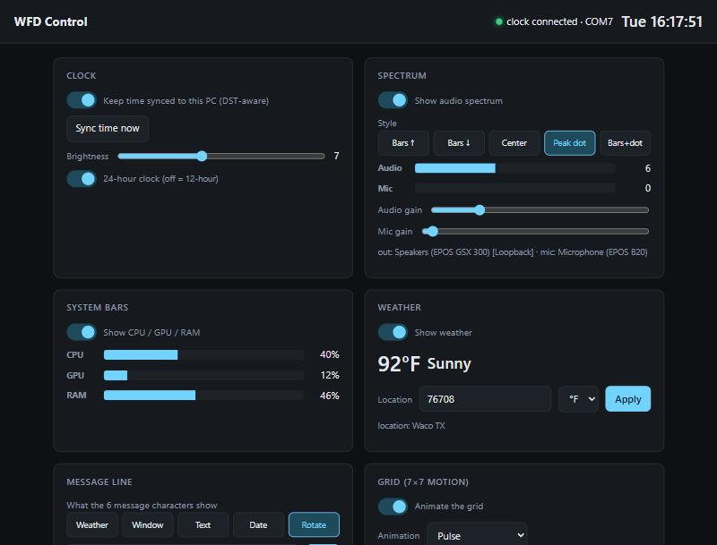
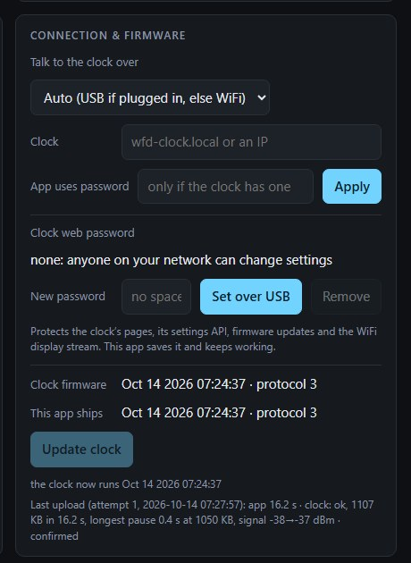

# WFD Control (PC app)

A local web app that serves a dashboard **and** runs the background services that feed the
clock the live, PC‑only data over USB or WiFi.

The app is **`wfd-app/` (Rust)**: a single `wfd-app.exe`, installed and started at login by
`wfd-app\install.ps1`. See [wfd-app/README.md](../wfd-app/README.md).

It was ported from an earlier Python app, which is retired: it's frozen in
[`legacy/python-app/`](../legacy/python-app/) and no longer tested in CI (see
[legacy/README.md](../legacy/README.md)).



## Running

The Rust app: download the zip from the [latest release](https://github.com/bstag/elekswfd-custom-firmware/releases/latest), unzip, and run
`powershell -ExecutionPolicy Bypass -File install.ps1` (no Rust needed). From a clone (needs
Rust from [rustup.rs](https://rustup.rs)):

```powershell
powershell -ExecutionPolicy Bypass -File wfd-app\install.ps1   # build, install, start at login
cd wfd-app; cargo run --release -- --no-browser                 # or run it by hand
```
It installs to `%LOCALAPPDATA%\WFD Clock\` (settings: `wfd_config.json` there). Run the
installer again after pulling changes.

Dashboard: **http://127.0.0.1:8737**. Add `--no-browser` to not auto‑open.

## What it provides

- **Clock** — time sync (DST‑aware), **12/24‑hour** format, brightness
- **Spectrum** — PC audio output (WASAPI loopback) on the left column, default mic on the
  right; five styles; gain sliders
- **System bars** — live CPU (psutil) / GPU (`nvidia-smi`) / RAM
- **Weather** — resolves a ZIP or "Town, State" and pushes it; shows condition + temp
- **Message line** — weather temp / window title / custom text / **date** / **forecast** / rotation; custom text supports `{date} {time} {time12} {day} {temp}` placeholders
- **Alarms & timer** — up to 4 alarms with weekdays and a countdown timer. They're the
  clock's settings and run on the clock (see FIRMWARE.md); an alert flashes the display until a
  clock button or *Stop* is pressed
- **Forecast** — today and the next days on the dashboard
- **Grid** — 14 animations incl. audio/CPU‑reactive and **Weather** (a pixel scene for the current
  weather; *Grid scene* under Weather & time zone picks one by hand); **Save to clock** makes the clock play the
  built‑ins itself, audio and mouth from its own mic (or stores your drawing); the **grid animator** (`/draw`) is a 7×7 frame editor with live preview. The same page is served by the clock at `http://wfd-clock.local/draw`; there it starts from the clock's stored drawing and saves straight to it
- **Top row** — icon modes (audio meter / system status) and the logo toggle
- **Offline message** + standalone toggles — what the clock shows when the app is off. *Save to clock*
  sends the text (placeholders and all); the clock's phone page picks the mode, rotation and speed

## How it drives the clock

A worker thread connects to the CH340 port (auto‑found by VID/PID `1A86:7523`), then at
~30 fps sends `SPEC`, and as needed `BARS`, `WX`, `MSG`, `GRID`, `ICON`, `LOGO`,
`STYLE`, `BRIGHT`, `GEO`, plus `SET` every 10 min. Uploads (`Save to clock`) go through
`GANIM` (built‑in grid animation, by name), `GCLR/GADD/GCOMMIT` (drawn grid frames) and `OMTEXT`
(offline message text). It reconnects automatically if the clock
is unplugged.

**It holds the serial port.** Stop the app (`Stop-Process -Name wfd-app`) before flashing
over USB or running the old vendor tool. (OTA over WiFi does **not** need the port free.)

## One dashboard

The app serves the clock's own dashboard (`wfd-firmware/clock/web/dashboard.html`), the same file
the clock serves at `http://wfd-clock.local/`. Served by the app, it also shows the PC sections:
PC audio and gains, CPU/GPU/RAM bars, the PC's weather, top‑row icons and logo, the message line
and grid *while the app runs*, and Connection & firmware. Everything else (brightness, format,
spectrum style, the mic, what the clock does when the app is off, ZIP, units, time zone) is the
clock's, so it looks and works the same on both. The grid animator (`/draw`) is shared the same
way. Tests check that every setting a shared page sends has an owner, and that every clock
setting has a control on the dashboard.

## Settings

Every setting has one owner:

- **The clock** owns everything about itself: brightness, 12/24‑hour, spectrum style, units,
  time zone, weather ZIP, the offline message, and all "when the app is off" behaviour. They
  live in the clock's flash. The app reads them over USB (`CFG`) when it connects and every
  5 s, and changes them with `CFGSET`. The clock checks them exactly as its own dashboard does.
  A change made on the clock's dashboard or phone page therefore shows up in the app, and the
  app never overwrites it.
- **The app** owns what needs the PC: PC audio spectrum and gains, CPU/GPU/RAM bars, the live
  message line (window title, custom text, rotation), live grid animations, icons and logo.
  These persist in the app's `wfd_config.json` (next to `wfd-app.exe`; `--config` picks
  another file).

The app's UI shows both together. Saving a clock setting while the clock is unplugged fails
with "clock not connected", and the clock's own error messages (e.g. a bad ZIP) are shown
as they are. The app's weather uses the clock's ZIP and units. It sends a location to the clock
(`GEO`) only if the clock has none.

## Auto‑start at login (Windows)

`wfd-app\install.ps1` adds a **WFD Clock** shortcut to your Startup folder (`shell:startup`)
that runs `wfd-app.exe --no-browser`. To disable, delete the shortcut.

If you're upgrading from the retired Python app, the installer also renames its login script
in Startup (a `.vbs` that started `app.py`) to `.vbs.disabled`, so only one app runs, and on a
first install it copies that app's `wfd_config.json`.

## Connection

The app talks to the clock over **USB** or **WiFi** (setting `link`, in the *Connection* section):

- **Auto** (default): USB when the clock is plugged in, otherwise WiFi. While on WiFi it checks
  for USB every 10 s and switches over once the port has opened. A port that another program
  holds, or a different board with the same USB chip (it doesn't answer `CFG`), is left alone
  for 5 minutes and WiFi keeps serving; the dashboard says which it is when nothing connects.
- **USB only** / **WiFi only**.

Finding the clock on WiFi, in order: a typed IP (`clock_host`), the address it last answered
on (kept in `clock-ip.txt` next to the settings, so it survives a restart), then its name. The
name lookup goes out on every network adapter and is repeated, so a VPN or virtual adapter
(Tailscale, Hyper-V, WSL) doesn't swallow it. A typed IP that stops answering falls back to
the name, since the router may have given the clock a new address.

Once connected over WiFi, one missed answer doesn't drop the link (the clock is busy for a few
seconds when it fetches the weather); 15 s of silence does. A display packet that Windows
fails to send (say "no buffer space", os error 10055) drops only that frame: the link stays up
while the clock answers, and if sends keep failing for about a second the app opens a new
socket (and says so on the dashboard if that doesn't help either). If the clock answers but
isn't taking the live display, the dashboard says why: a wrong or missing clock password, or UDP
port 4210 blocked. The display stream stops while "Update clock" uploads firmware.

If the clock is plugged in but Windows has no driver for its USB chip (no COM port), the
dashboard says so and links to the driver (see
[FLASHING.md](FLASHING.md#the-usb-driver-ch340)). `cargo run --example usb_probe` in `wfd-app/`
lists the USB devices the app sees.

Over WiFi, each frame's display commands go to the clock as one UDP packet, and settings and
uploads use the clock's web API. The clock is found as `wfd-clock.local`: the app asks over mDNS
itself, because Windows doesn't always resolve `.local` names. You can also enter an IP
(`clock_host`). Over USB the clock tells the app its WiFi address (`_ip` in `CFG`), so "Update clock" and a switch to WiFi go straight there; otherwise the app remembers the last address that worked, and forgets it if it stops answering. To set the clock's web password, use *Clock web password* in this section while the clock is on USB: it's sent over USB only, so only someone with the clock in hand can change it, and the app saves it as its own password (`clock_pass`) so WiFi and updates keep working. If the clock already has a web password set some other way
(serial `WEBPASS`), enter it as the clock password (`clock_pass`). The app never shows it back.
A clock with internet time (NTP) keeps its own time, over WiFi and over USB (`_ntp` in `CFG`);
the app sends the PC's time only if the clock hasn't synced, or when you press *Sync now*. The
clock shows that time in its own *Time zone* setting, so set that if it differs from the PC's.

`wfd-app.log` (next to the settings) records starts and stops, panics, each time the clock
connects and why a link was lost; a repeating line is written at most once in 10 minutes. A
worker thread that crashes is started again (after 2 s, then longer each time, up to a minute).
The GPU load comes from Windows' own counters (`GPU Engine`, what Task Manager shows): the
busiest engine of any GPU in the PC, NVIDIA, AMD or Intel. Only where Windows has no such
counters does the app fall back to one `nvidia-smi` kept running in its repeat mode (it ends
with the app).

The clock still needs power, so a USB charger is enough once the app uses WiFi.

**Firmware updates:** the Connection section shows the clock's firmware next to the one this app
ships (`wfd-firmware/releases/`). It warns if the clock is older than the app expects (protocol),
and **Update clock** uploads the shipped build over WiFi (this works while the display runs over
USB too). The app then watches the clock until it reports the new build. That takes about 20 s.



If an upload stalls, the app tries once more.

Every attempt is logged as one JSON line in `ota-log.jsonl` next to the settings file:
the app's side (seconds sending, any error, whether the new build came up) and the clock's own
report of that upload (`state.ota`, see FIRMWARE.md). The dashboard shows the last one under the
Update button. A stall shows up as a large `max_gap_ms` and `gap_at` says how far in it came.

When the app quits normally it sends `BYE`, so the clock takes over at once instead of after 2 s.

## App and clock together

While the app is connected it drives the live display (spectrum, bars, message line, grid).
When it stops, the clock carries on with its own settings after 2 s. Settings never fight:
see *Settings* above.

## Note on the older headless helper

`legacy/daemon/wfd_daemon.py` is a superseded headless version (time + mic spectrum only).
The PC app replaces it with the full UI and feature set.

## Tests

The app: `cd wfd-app && cargo test` (see [wfd-app/README.md](../wfd-app/README.md)). No
clock, network or audio device is needed. Its golden log
(`wfd-app/tests/fixtures/clocklink_golden.log`) is a regression snapshot of every line the
app sends in a busy simulated scenario. If you change what the app sends on purpose, the test
fails with a diff: `WFD_UPDATE_GOLDEN=1 cargo test --test clocklink` writes the new output to
`clocklink_golden.log.new`; review it, replace the snapshot with it and commit both together.

The firmware's host tests (its C++ engines built on the PC, its tools, opt-in real-clock tests)
live in `wfd-firmware/tests/`; see [FIRMWARE.md](FIRMWARE.md#host-tests).

GitHub Actions (`.github/workflows/ci.yml`) runs the app's tests and clippy, the firmware host
tests and the firmware build on every push and pull request; the firmware job also fails if
`src/web_pages.h` wasn't regenerated after a page change. The retired Python app's own suite
(`legacy/python-app/tests`) is not run in CI.
