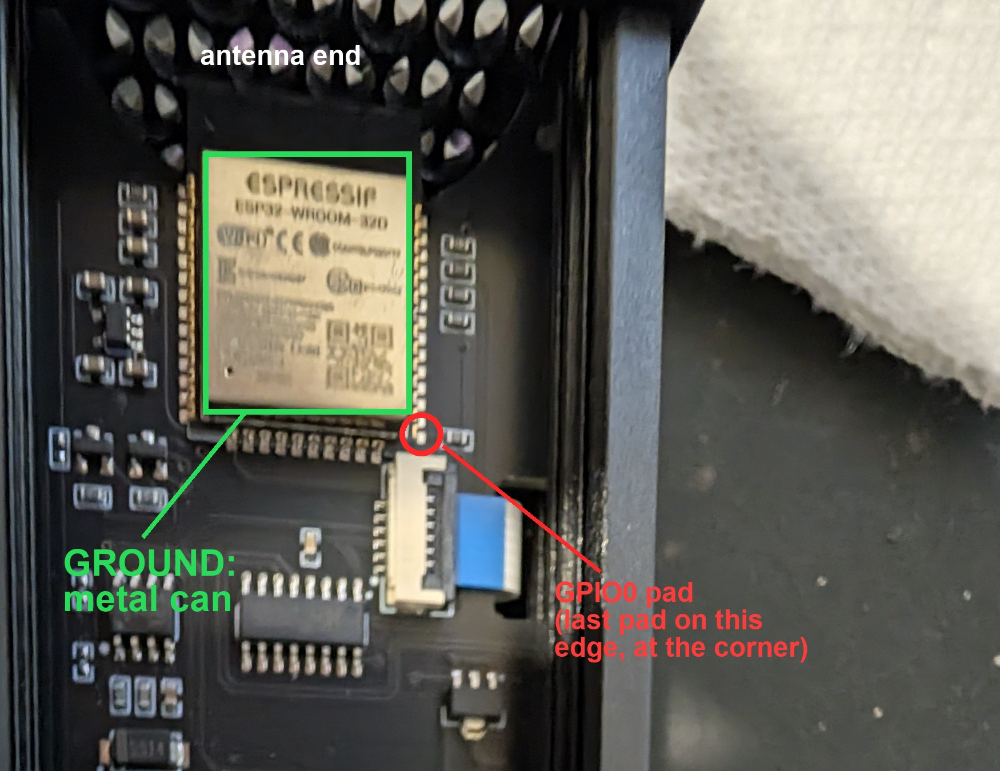

# Hardware

## Chips

| Part | Role |
|---|---|
| **ESP32‑WROOM‑32D** | Main MCU (dual‑core 240 MHz, WiFi/BT, 4 MB flash) |
| **TM1680** (Titan Micro) | LED matrix driver, I²C, on the display board — drives the whole panel |
| **DS3231SN** | Battery‑backed real‑time clock (I²C), with a CR1220 coin cell |
| **CH340C** | USB‑to‑serial bridge (VID `1A86`, PID `7523`) |
| XINLUDA XL358‑type | Dual op‑amp — microphone amplifier (output rests near 0 V, swings up with sound; see [FIRMWARE.md](FIRMWARE.md#microphone-when-the-app-is-off)) |
| 2× SS14 | Schottky diodes (power) |

The display is an **LED panel** (not VFD).

## Pinout (ESP32)

| Signal | Pin |
|---|---|
| I²C SDA | GPIO21 |
| I²C SCL | GPIO22 |
| Buttons | GPIO25, GPIO26, GPIO27 (pressed = LOW) |
| Microphone (ADC) | GPIO32 (ADC1_CH4) |
| USB serial | UART0 (via CH340), 115200 8N1 |

I²C addresses: **DS3231 = 0x68**, **TM1680 = 0x73**.

To flash manually you hold GPIO0 low at reset; on this board the CH340 auto‑reset only
works on USB 2.0 (see [FLASHING.md](FLASHING.md)).

If it won't enter download mode, short the GPIO0 pad (the last pad at the corner of the module,
next to the ribbon connector) to the module's metal can (ground) while it resets:

## Display

The TM1680 exposes **42 bytes of display RAM** (write address `0x00`, then the data
bytes). Init sequence: `80 A4 98 81 83 Bx 88` (x = brightness nibble). Everything on the
panel is one bit in that RAM.

**Colours are fixed per LED.** The panel isn't a VFD and isn't one colour: it's ordinary LEDs
behind the front window, and each one has its own colour:

| Area | Colour |
|---|---|
| Clock digits, message line | white |
| 7×7 dot grid | white |
| Weekday indicators | white |
| CPU/GPU/RAM meters | green → yellow → red along the bar |
| Spectrum (audio) columns | green → yellow → red, the same scale |
| `%` signs | green |
| CPU label | red |
| `SUNNY` weather word | red |

The TM1680 only switches each LED on or off, and brightness is one setting for the whole panel.
Software can choose which LEDs light, but it can't change their colour or dim one area against
another. (A meter turns red because the LEDs near its top end are red ones.)

Panel elements (all mapped in `wfd-firmware/clock/src/clock_panel.h`):

| Element | Count | Notes |
|---|---|---|
| 7‑segment clock digits | 6 | one byte each (bytes 12,14,16,18,20,22) |
| Colons | 2 | |
| 14‑segment message chars | 6 | full top/mid/bottom bars + diagonals |
| 7×7 grid | 49 | + a separate border **frame** (12 LEDs) |
| Spectrum columns | 2 × 12 | |
| CPU/GPU/RAM bars | 3 × 20 | + labels + `%` signs |
| Weekday indicators | 7 | Mon–Sat use 2 LEDs, **Sun only 1** (so it reads dimmer) |
| Top‑row icons | 13 | speaker, mic, headphones, vinyl, mixer, monitor, tower, server, clock, hourglass, battery, calendar, wifi |
| ELEKSMAKER logo | 4 bytes | |

### 7‑segment digit font
`a=0x10 b=0x20 c=0x40 d=0x80 e=0x01 f=0x02 g=0x04` (validated). The 14‑segment message
chars reuse this subset in their low byte, so numbers render with the same font; the
diagonals (`h,i,j,k,l,m`) are in the high byte. Full font in
`wfd-control/font14.py` and `wfd-firmware/clock/src/font14_table.h`.

## How the panel was mapped

There's no datasheet for the wiring, so the LED → RAM‑bit map was discovered interactively:

1. **`wfd-firmware/tools/mapper.py`** lights one RAM bit at a time; you click the matching
   spot on a drawing of the panel in the browser. 384 bits → full element map.
2. **`wfd-firmware/tools/segmap.py`** does the same per‑segment for one digit and one
   character, to pin down the 7‑ and 14‑segment layouts.
3. The results are generated into `wfd-firmware/clock/src/clock_panel.h`.

The reverse‑engineering of the original serial protocol is in [../PROTOCOL.md](../PROTOCOL.md).
